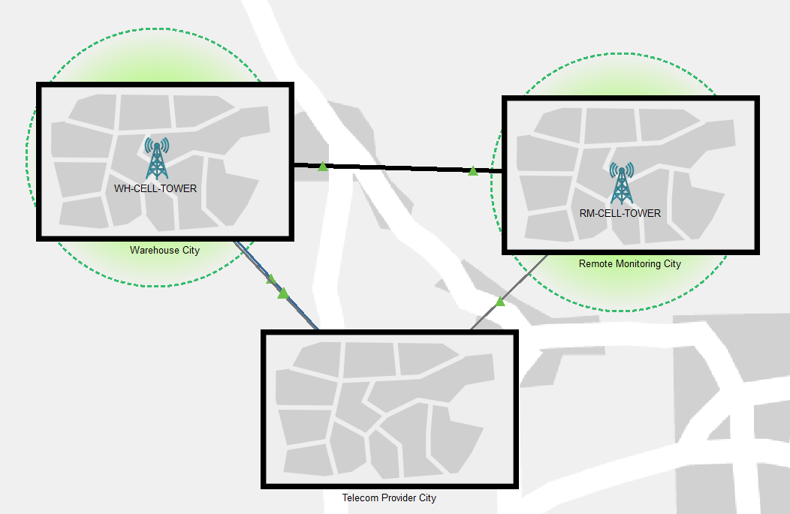
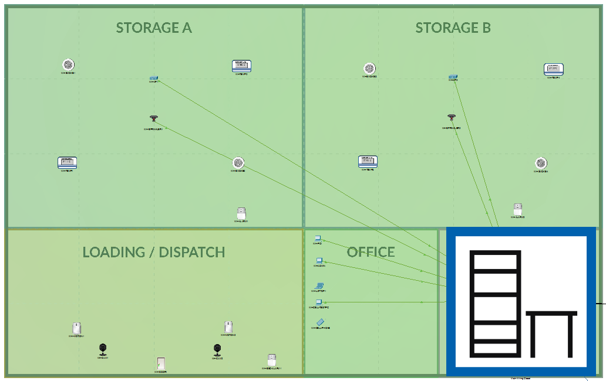
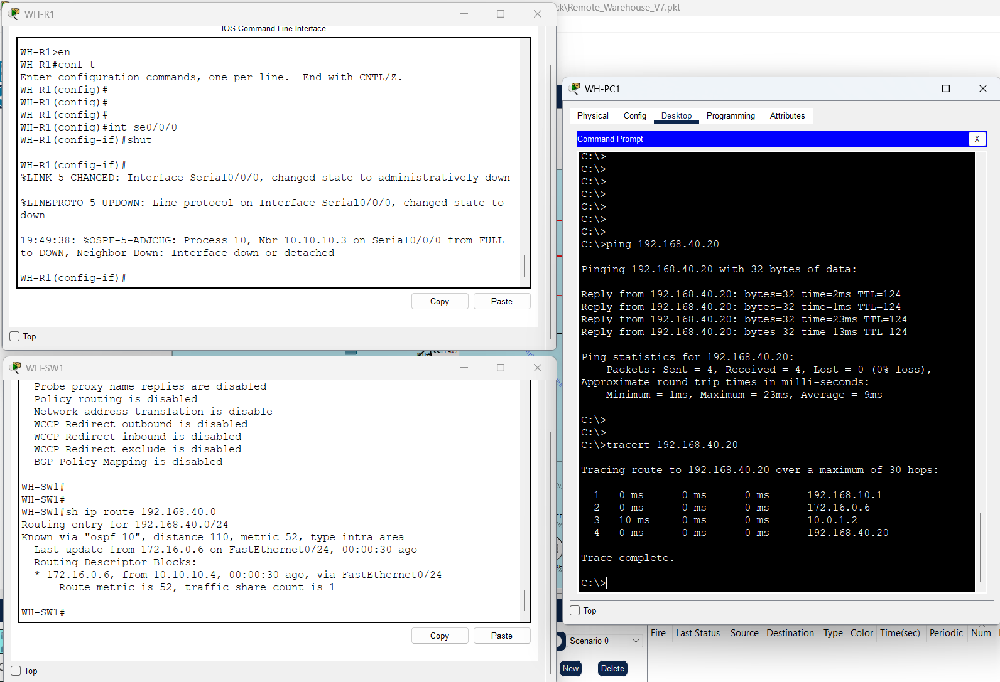
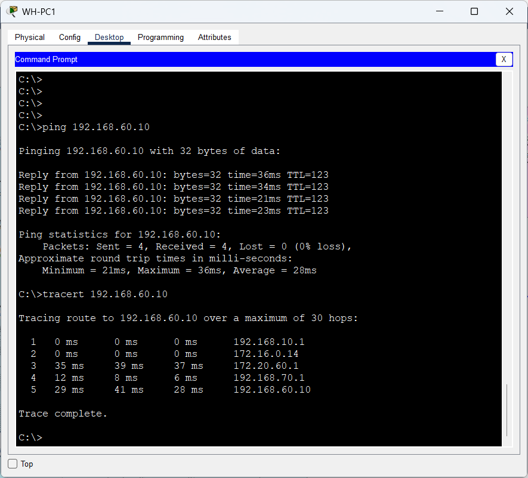
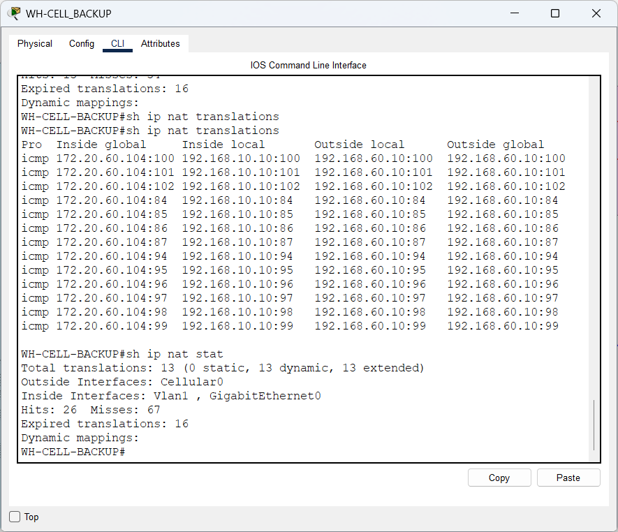
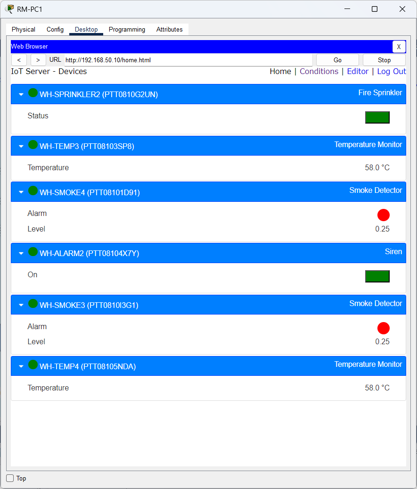
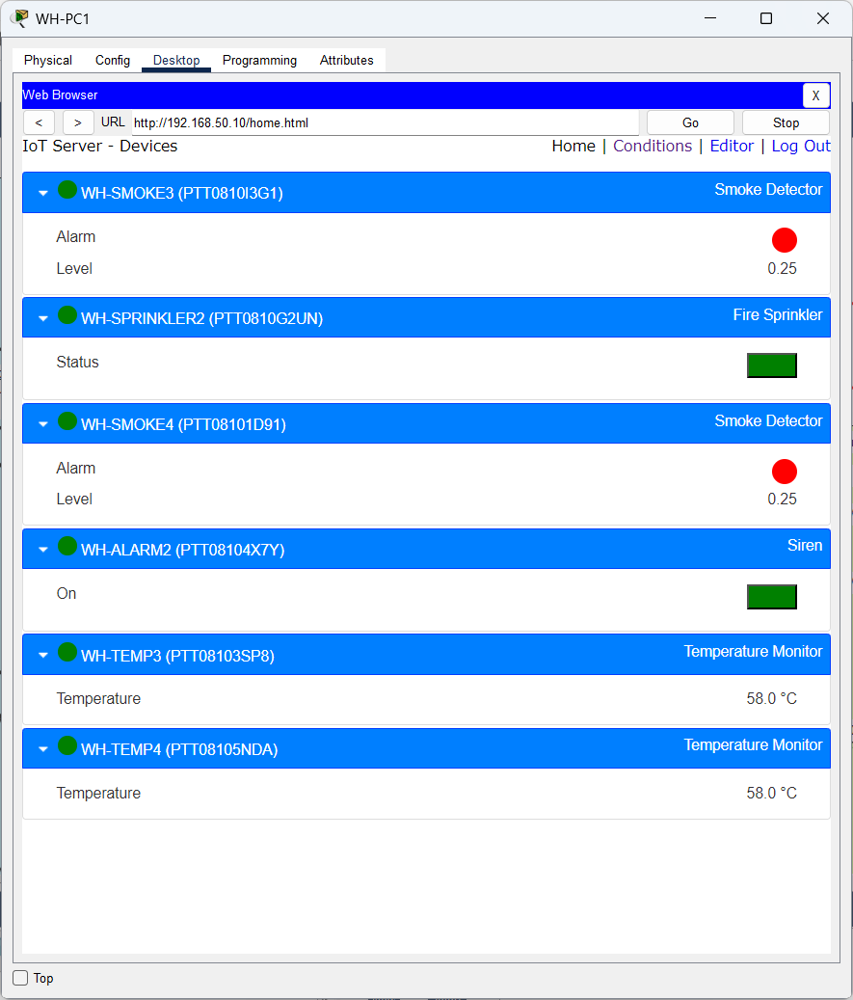
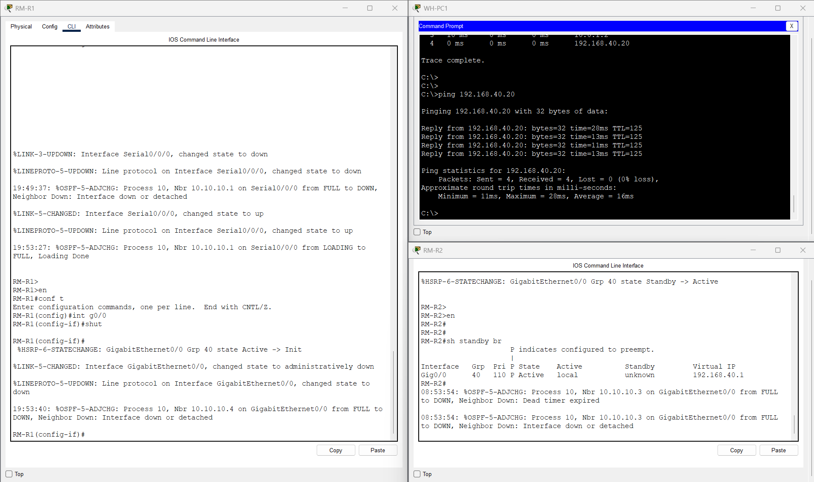
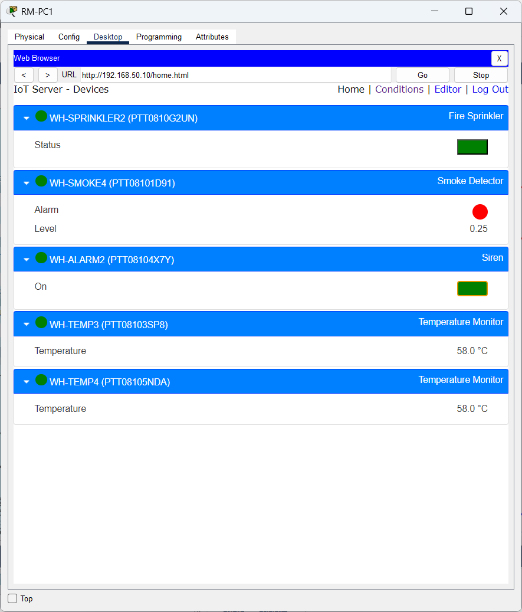

# Remote Warehouse Monitoring System

**Cisco Packet Tracer | IoT Monitoring · Fog Computing · Resilient Enterprise Networking**

A Cisco Packet Tracer simulation of a warehouse monitored from a separate site. The network combines smoke and temperature detection, intrusion monitoring, local automated responses, wireless segmentation, redundant WAN connections, cloud access and a simulated cellular backup.

[**Open the final Packet Tracer project**](simulation/Remote_Warehouse_Monitoring_System.pkt) · [**Browse all simulation screenshots**](evidence/)

## The simulation

These are screenshots from the actual Packet Tracer project, rather than a reconstructed network illustration.

### Geographically separated sites and cellular coverage

*Physical Workspace: warehouse, remote monitoring and provider locations with simulated cellular coverage.*

### Warehouse floor plan and IoT placement

*Warehouse Physical Workspace: fire sensors, intrusion devices, access points and office equipment placed in their operating areas.*

## Architecture

- **Warehouse:** Multilayer core switch, access switch, wireless LAN controller, two lightweight access points, office devices and a local fog IoT registration server.
- **IoT monitoring:** Smoke detectors, temperature monitors, sirens, sprinklers, motion detectors, cameras and smart-door devices across Storage A, Storage B and the loading area.
- **Remote monitoring:** Two routers, an access switch, monitoring PC and remote IoT registration server.
- **Inter-site WAN:** Two routed, provider-managed leased-circuit *representations* using serial interfaces, with OSPF selecting an alternate path when a link fails.
- **Cloud:** ISP edge and cloud routing with eBGP peering.
- **Cellular:** A separate simulated 3G/4G connection used as an alternative route to cloud services.

For a simplified connection-oriented illustration, see [the logical network diagram](assets/network-architecture.svg).

## Technologies implemented

| Area | Implementation |
| --- | --- |
| Segmentation | VLAN 10 office, VLAN 20 IoT, VLAN 30 employee WLAN, VLAN 50 fog computing, VLAN 99 management |
| Wireless | WLC, two lightweight access points and separate employee/IoT WLANs |
| Routing | OSPF, EIGRP and eBGP |
| Redundancy | Dual leased-WAN paths, OSPF reconvergence, HSRP gateway failover and a floating cellular backup route |
| Traffic management | QoS classes prioritising fog-related and IoT traffic |
| Security | Named ACLs restricting access to management networks |
| Local automation | Smoke- and heat-based IoT Conditions on the warehouse fog server |

## Demonstrated tests

### 1. Dual leased-WAN failover

The warehouse and monitoring site use two inter-site paths. When the primary circuit was shut down, the backup OSPF route became active and the warehouse PC could still reach the remote monitoring network.

### 2. Cellular cloud backup

During a primary cloud connection failure, traffic took the cellular path to the cloud server. The traceroute and the cellular router's NAT table were used to verify the alternative path.

### 3. Confirmed-fire detection

Storage B uses redundant smoke and temperature monitors. Smoke or high temperature independently triggers a warning. The simulated sprinkler is activated when a smoke condition and a high-temperature condition both meet the configured thresholds.

*Example test: smoke level 0.25 and temperature 58°C; the fire-response outputs are active.*

### 4. Local fog monitoring during WAN failure

The warehouse fog server remains on the local VLAN. With both inter-site serial WAN links disabled, a warehouse PC was still able to reach the fog server and view an active fire-response scenario.

### 5. Additional routing, resilience and IoT evidence

Other recorded tests include OSPF and BGP adjacency, HSRP router takeover, WAN QoS counters and sensor redundancy.

| Routing and gateway redundancy | Sensor redundancy |
| --- | --- |
|  |  |

[**View the complete evidence folder**](evidence/) for all uploaded screenshots.

## Run the simulation

1. Download [`Remote_Warehouse_Monitoring_System.pkt`](simulation/Remote_Warehouse_Monitoring_System.pkt).
2. Open the file in a compatible version of **Cisco Packet Tracer**.
3. Allow the topology and IoT registrations to initialise.
4. Explore the Logical and Physical workspaces. For IoT tests, use the remote monitoring PC to access the warehouse fog dashboard at `http://192.168.50.10` or the remote monitoring server at `http://192.168.40.20`.
5. Save a copy before shutting down WAN interfaces or changing the simulation environment.

## Scope and limitations

This project is an educational network simulation, **not a deployed or certified fire-protection system**. Serial interfaces represent provider-managed intercity connectivity rather than literal long-distance serial cabling. The cellular devices simulate **3G/4G**, not 5G NR or guaranteed URLLC performance. SD-WAN orchestration, NFV and advanced radio behaviour are discussed as architectural considerations, not implemented simulator features. The recorded failover tests show behaviour under the tested link faults rather than exhaustive real-world resilience.

*Remote Warehouse Monitoring System · 2026 · Cisco Packet Tracer*
